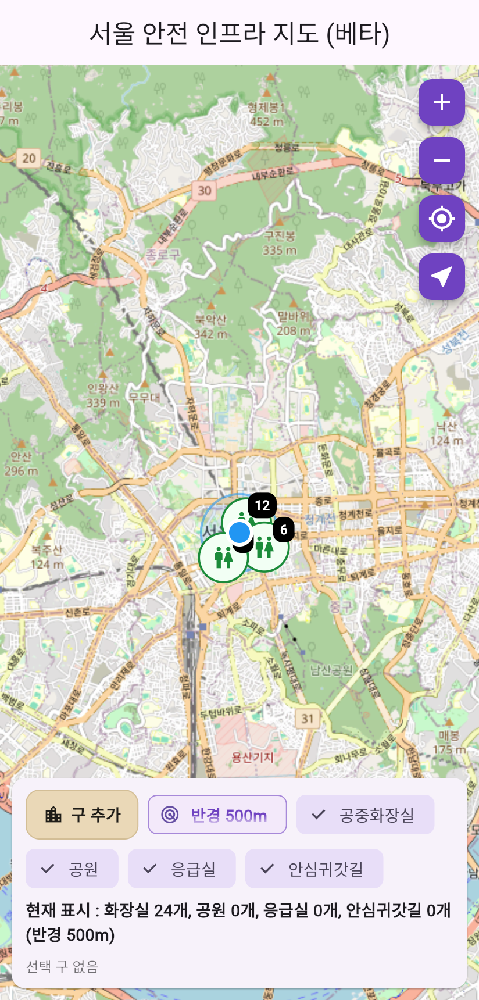
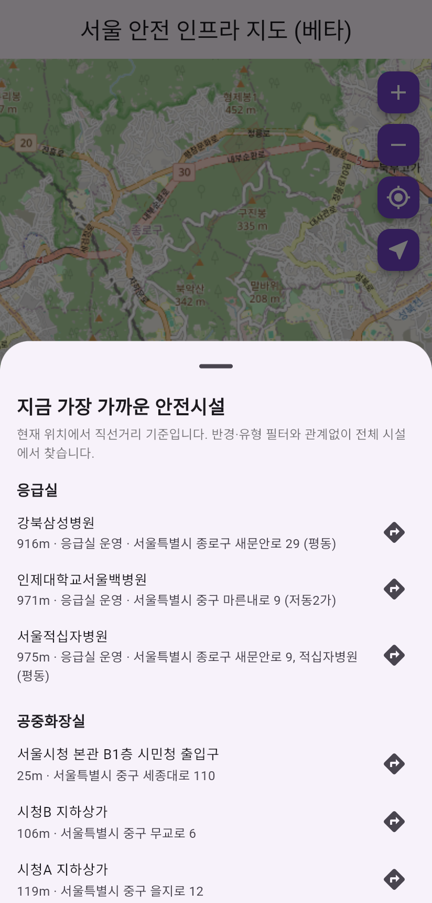
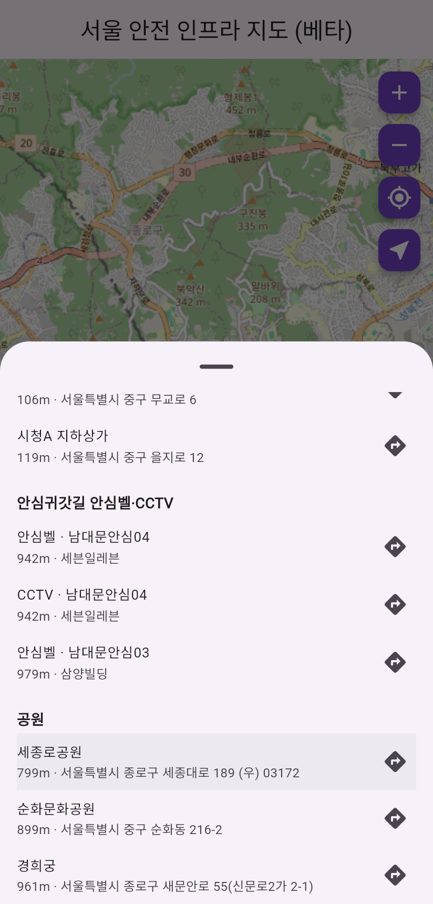

# 서울 안전시설 지도 (Seoul Safety Facility Map)

> 서울시 Open API의 공중화장실·응급실·공원·안심귀갓길 시설을 지도 위에 모아 보여 주고, 지금 위치에서 가장 가까운 곳을 찾아 주는 Flutter 앱.
>
> **English:** A Flutter app that puts Seoul's public toilets, emergency rooms, parks and safe-return-route facilities (Seoul Open API) on one map
> and lists the closest ones to where you are, with a route link. Built as a university graduation project; see [English summary](#english-summary).

| 지도 (반경 500m) | 가장 가까운 안전시설 | (계속) |
|---|---|---|
|  |  |  |

위 화면은 웹 빌드를 위치 고정(서울시청)으로 실행해 찍었다(2026-10-05). 졸업작품 당시 Android 기기 화면은 [여기](docs/images/android-2026-05.png).

## 배경

졸업작품으로 만들었다. 공원, 병원, 화장실 같은 안전 관련 시설이 서비스마다 흩어져 있어 한눈에 보기 어렵다는 문제에서 출발했다.
졸업 후 공개하면서 실제로 쓸 수 있도록 고친 점은 [졸업작품 이후 변경 사항](#졸업작품-이후-변경-사항)에 적었다.

## My Role (졸업작품 당시 원문)

- Implemented Flutter-based mobile UI
- Integrated Seoul Open API
- Implemented map visualization features
- Developed GPS-based search functionality

## 기능

- **4종 시설 지도:** 공중화장실(약 4,400곳), 응급실(77곳), 공원(133곳), 안심귀갓길 시설물(약 11,900개)을 서울시 Open API에서 전부 받아 표시한다.
- **반경·유형·구 필터:** 현재 위치 기준 500m~30km 반경, 시설 유형, 자치구를 골라 볼 수 있다.
- **가장 가까운 안전시설:** 지도 오른쪽의 ↗ 버튼을 누르면 유형별로 가장 가까운 3곳을 직선거리 순으로 보여 준다.
  안심귀갓길 시설은 위급할 때 찾아갈 수 있는 안심벨과 CCTV(약 2,500개)만 고른다. 보안등, 노면표기 같은 시설은 지도에만 나온다.
  항목을 누르면 지도가 그 위치로 이동하고, 길찾기 버튼은 카카오맵 경로를 연다. 반경·유형 필터와 관계없이 전체 시설에서 찾는다.
- **상세 정보:** 마커를 누르면 전화, 홈페이지, 응급실 정보 등을 볼 수 있다.

응급실 운영 여부는 데이터의 `DUTYERYN`(응급실 운영 신고)으로 표시한다. 데이터의 요일별 시간(`DUTYTIME*`)은 **외래 진료시간**이라
응급실 운영시간으로 쓰지 않는다. 응급 상황에서는 지도보다 119에 먼저 연락하자.

## 실행

Flutter 3.38 이상(Dart 3.10 이상)이 필요하다.

1. [서울 열린데이터광장](https://data.seoul.go.kr)에서 일반 인증키를 발급받는다(무료, 마이페이지 → 인증키 신청).
2. 키를 저장소 루트의 `dart_defines.json`에 넣는다. 이 파일은 `.gitignore`에 들어 있다.

   ```json
   {"SEOUL_API_KEY": "발급받은-인증키"}
   ```

3. 실행한다.

   ```bash
   flutter pub get
   flutter run --dart-define-from-file=dart_defines.json
   ```

키 없이 실행하면 "인증키가 없습니다" 오류가 표시된다. `flutter run -d chrome`으로 웹에서도 돌아간다(서울시 API가 교차 출처 요청을 허용한다).
다만 웹 빌드에는 키가 그대로 들어가므로 키를 넣은 빌드를 공개 배포하지 말자.

## 알아 둘 점

- 서울시 Open API는 HTTP(포트 8088)만 지원한다. Android(`network_security_config.xml`)와 iOS(`Info.plist`) 모두 이 도메인 하나만 HTTP를 허용한다.
- 앱을 켤 때마다 전체 데이터(약 16,500건, 19회 요청)를 새로 받는다. 시청 근처에서 측정했을 때 약 3초 걸렸다. 저장(캐시)은 하지 않는다.
- 좌표가 없는 시설은 OpenStreetMap Nominatim으로 주소를 좌표로 바꾼다. 이용 규칙에 맞춰 1초에 한 번만 요청하고 결과를 기억한다(현재 데이터에서는 공원 1곳).
- 안심귀갓길 시설물은 "안심벨 · 남대문안심04"처럼 시설 종류와 노선 이름으로 표시한다. 시설 코드(`FACI_CODE` 301~308)의 의미는
  열린데이터광장의 [`안심귀갓길_안전시설물(코드유형).xlsx`](https://data.seoul.go.kr/dataList/OA-21696/S/1/datasetView.do)를 따랐다.
  전체 11,883개 중 보안등 5,618, 112 위치 신고 안내 1,758, 노면표기 1,498, CCTV 1,487, 안심벨 1,001, 안내표지판 376, 기타 75, 서비스 안내판 70이다(2026-10-05).
- 지도 타일은 OpenStreetMap 공개 타일 서버를 쓴다. 대량 사용에는 맞지 않는다.
- 이 저장소에서는 Android·iOS 실기기 빌드를 다시 확인하지 못했다. 웹 빌드와 단위 테스트로 확인했다.

## 개발

```bash
flutter analyze
flutter test        # 좌표 해석, API 페이지 처리, 가까운 시설 정렬, 응급실 표시 규칙 (키·네트워크 불필요)
```

GitHub Actions가 같은 검사를 돌린다.

```
lib/
  core/seoul_api.dart          서울시 Open API 클라이언트, Nominatim 지오코딩
  core/coord_parser.dart       데이터셋별 좌표 필드 해석
  features/map/map_vm.dart     데이터 로딩, 필터, 응급실 규칙
  features/map/map_page.dart   지도 화면
  features/map/nearest.dart    가까운 시설 계산, 거리 표시, 길찾기 링크
```

## 졸업작품 이후 변경 사항

졸업작품 당시 버전은 git 태그 [`graduation-submission`](../../tree/graduation-submission)으로 남겨 두었다.

- 소스에 들어 있던 API 인증키를 지우고 `--dart-define-from-file`로 받게 했다.
- 시설별 1,500건 상한을 없앴다. 전에는 화장실 4,455곳 중 1,500곳, 안심귀갓길 11,883개 중 1,500개만 보였다.
- 공원 좌표 필드(`XCRD`/`YCRD`)를 읽지 못해 앱을 켤 때마다 공원 133곳을 전부 Nominatim에 연달아 조회하던 문제를 고쳤다.
- 응급실을 외래 진료시간으로 "운영중" 판정하던 문제를 고쳤다. 밤에는 77곳 중 74곳이 운영하지 않는 것처럼 보일 수 있었다.
- 앱 전체 HTTP 허용을 서울시 API 도메인으로 좁혔고, iOS 위치 권한 문구와 HTTP 예외를 추가했다.
- 안심귀갓길 시설에 종류(안심벨, CCTV, 보안등 등)를 표시한다. 전에는 모두 노선 이름으로만 보였다.
- "가장 가까운 안전시설" 기능, 단위 테스트 19개, CI를 추가했다. 앱 이름을 `university`에서 "서울 안전시설 지도"로 바꿨다.

## English summary

A graduation project: a Flutter map of Seoul's public toilets, emergency rooms, parks and safe-return-route facilities from the Seoul Open API,
with radius, type and district filters and a "closest safety facilities" sheet that links to Kakao Map directions.
To run it, get a free key from [data.seoul.go.kr](https://data.seoul.go.kr), put `{"SEOUL_API_KEY": "..."}` in `dart_defines.json`, and run
`flutter run --dart-define-from-file=dart_defines.json`. Emergency-room status comes from `DUTYERYN`; the `DUTYTIME*` fields are outpatient hours.

## 라이선스

[MIT](LICENSE)
